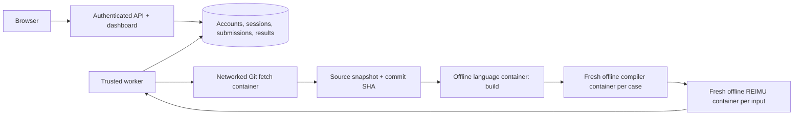

# Rx Online Judge

A compiler-course judge for the sibling [`rx-compiler`](../rx-compiler/README-EN.md)
project. Students sign in with administrator-provisioned accounts and submit a **public
Git repository**, its branch/tag/commit, an implementation language, and a whole test
suite. The judge fetches the source, builds the compiler, and runs Rx tests in containers.


## Suite progression

There are exactly three selectable suites. Later suites always include all earlier suites,
with execution ordered semantic → codegen → optimization:

| Selected suite | What runs | Current official test count |
|---|---|---:|
| Semantic | Every semantic testcase | 236 |
| Code generation | Every semantic and codegen testcase | 296 |
| Optimization | Every semantic, codegen, and optimization testcase | 309 |

Counts come from the configured manifests; they are not hardcoded into grading.
There is no per-testcase or directory filter, and the API rejects extra selection fields.
All selected tests run even if an earlier test fails. A submission is accepted only if
all tests pass. Per-case diagnostics remain visible for debugging.

## Optimization leaderboard


The **Leaderboard** page ranks active accounts by their best fully accepted optimization
submission against the current test catalog. Every semantic and codegen testcase must pass
too. Each account has one entry; lower scores rank higher, and equal scores share a rank.
For equally scoring submissions from one account, the earliest completed one is shown.
All signed-in accounts can see the rankings and expand scores to inspect testcase ratios.
Submission diagnostics remain accessible only to the owner and administrators.

For optimization testcase `i`, first sum REIMU cycles over **all its input/output pairs**.
The official Rust baseline is the smallest correct total for that testcase across
`-C opt-level=0, 1, 2, 3, s, z`. Each variant uses the corresponding Cargo release
optimization level for the reference runtime as well, with the template's other flags
(including fat LTO) retained. A variant must pass every input of a testcase to supply its
baseline; compile failures, REIMU errors, timeouts, and nonpositive cycles are excluded.
The best flag may differ between testcases; inputs within a testcase use one variant.

```text
baseline_i = min(total cycles of each correct Rust variant for testcase i)
ratio_i    = submission_cycles_i / baseline_i
score      = exp(sum(log(ratio_i)) / number_of_optimization_testcases)
```

Each testcase has equal weight in the geometric mean. `1.0` matches the baseline;
`0.8` means a geometric mean cycle ratio of 80%; `1.2` means 120%. There is no cap or
inversion. Failed, incomplete, cancelled, older-catalog, and ownerless legacy submissions
do not rank. Accepted submission details also show the score and testcase breakdown.

After building images and starting the judge, generate the baseline:

```sh
make baseline
# Equivalent:
docker compose run --rm --no-deps baseline
```

This uses the official Rust toolchain in the configured `rust` language image, the
reference helpers and `config.mk` from `../rx-compiler`, and the judge's trusted REIMU
image. Set `RX_REFERENCE_PATH` for a different reference checkout. Compilation and
execution use the same offline containers, limits, inputs, and correctness checks as
submissions. The baseline job measures optimization tests only; student submissions
still run the complete cumulative suite.

Publication is atomic: every optimization testcase must have a valid baseline before it
replaces the active one. Failed or interrupted generation leaves the previous baseline
active. The database retains previous baseline records. Full measurements, diagnostics,
Rust version, image IDs, source fingerprint, and catalog fingerprint are also saved to
`/data/optimization-baseline.json` in the persistent judge volume. Export them with:

```sh
docker compose cp api:/data/optimization-baseline.json ./data/optimization-baseline.json
```

Existing accepted submissions receive scores immediately when a matching baseline is
activated. Regenerate after changing the catalog, reference compiler, or runtime. A
catalog mismatch disables scoring until a new baseline and matching submissions exist.
If the REIMU image or runtime configuration changes, rerun submissions as well; historical
submissions record the catalog version but do not record the runtime image they used.

For local development using `./data`:

```sh
uv run python -m rx_oj.baseline --reference-dir ../rx-compiler \
  --output data/optimization-baseline.json
```

## Start the judge

Requirements: Linux Docker with cgroup limits, Docker Compose, Python 3 for setup scripts,
and sibling checkouts:

```text
Compiler/
├── rx-compiler/        # tests/official and vendor/REIMU submodules initialized
└── rx-online-judge/
```

From `rx-online-judge`:

```sh
git -C ../rx-compiler submodule update --init --recursive
python3 scripts/setup.py
python3 scripts/build_images.py
docker compose up --build -d
```

The dashboard is at **http://localhost:8000**. The API binds to loopback by default.
Create accounts before signing in; there is no default password or web registration.

## Accounts and administration

Provision accounts through the operator CLI, which prompts for a password without echoing it:

```sh
docker compose exec api python -m rx_oj.admin create-user admin --admin
docker compose exec api python -m rx_oj.admin create-user alice
docker compose exec api python -m rx_oj.admin list-users
docker compose exec api python -m rx_oj.admin reset-password alice
docker compose exec api python -m rx_oj.admin disable-user alice
docker compose exec api python -m rx_oj.admin enable-user alice
```

Use `--password-stdin` on create/reset for provisioning scripts; do not pass passwords in
command-line arguments. Passwords must have 12–256 characters. Usernames are normalized to
lowercase and have 3–40 letters, digits, dots, underscores, or hyphens.

- Students list, inspect, and cancel **their own** submissions.
- Administrators can inspect and cancel all submissions. Creating/resetting/disabling
  accounts is an operator CLI action, not a public website endpoint.
- Users can change their own password from the account dialog.
- Passwords use individually salted scrypt hashes (`N=32768, r=8, p=3`).
- Sessions expire after 12 hours. Only token hashes are stored in SQLite. Cookies are
  HttpOnly and SameSite=Strict; state-changing requests also require a CSRF token.
- Logout revokes the current session. Password resets/changes and account disabling
  revoke every session belonging to the user. Login failures are throttled per username
  and client IP over a five-minute window.

For HTTPS deployment, set `OJ_SECURE_COOKIES=1` and configure Uvicorn's trusted proxy
settings to recognize your proxy's forwarded scheme. Browser origins must match the API
origin. There is no cookie-free shared-token or unauthenticated development bypass.

## Submit from Git

Provide a public HTTPS repository URL and a Git ref, for example:

```text
Repository: https://github.com/your-account/rx-compiler.git
Git ref:    main
Language:   Rust
Suite:      Code generation
```

`HEAD` uses the repository's default branch. Branches, tags, `refs/heads/...`, and commit
SHAs are supported. **A moving branch is resolved when the worker fetches it**; submit a
full commit SHA when you need an exact revision. Every successful fetch records its actual
commit SHA in the result and stores a bounded source snapshot for traceability.

Only public repositories are supported: no credentials, private access tokens, SSH URLs,
local paths, arbitrary transports, or uploaded archives. The default allowed hosts are
`github.com`, `gitlab.com`, `codeberg.org`, and `gitee.com`. Operators can configure
`OJ_GIT_HOSTS` identically on API and worker for other trusted public HTTPS Git hosts.
Git redirects, interactive prompts, credential helpers, hooks, recursive submodules,
and automatic Git LFS downloads are disabled. Use the canonical repository URL if it has
moved. Commit all required source/dependency files directly into the repository.

The repository must contain `config.mk` and the compiler source at its root. Ordinary
file symlinks, such as the template's README link, are materialized safely inside the
source archive. Directory, dangling, cyclic, and escaping links are rejected. Source
archives are never extracted onto the host.

The existing reference compiler can be submitted directly:

```text
https://github.com/ACMClassCourse-2025/rx-compiler.git
```

Select **Rust**; its original `config.mk` is supported.

## Compiler contract

```make
BUILD = g++ -std=c++23 -O2 src/main.cpp -o compiler
SEMANTIC = ./compiler --stage semantic {source}
CODEGEN = ./compiler --stage codegen {source} -o {output}
```

- `BUILD` runs once and may be empty. `/workspace` is snapshotted after building.
- `SEMANTIC` exits **0** to accept and **1** to reject. Other exits, signals, and timeouts
  fail even negative testcases.
- `CODEGEN` exits 0 and writes **self-contained RV32IM assembly** to `{output}`. Include any
  compiler runtime assembly in that file.
- `{source}` and `{output}` are substituted as shell-quoted absolute paths. Make variable
  expansion is supported. Commands run in `/workspace`.
- The worker always runs its trusted REIMU image; a submission's `RUN` command is ignored.
- Outputs must match every input/output pair byte-for-byte, including final newlines.
- Optimization cases additionally report REIMU's `Total cycles: N`. Totals count only fully
  passing optimization cases.
- `lex` and `parse` manifests are skipped, matching the compiler template.

Implementation images support C/C++ (GCC 14), Rust 1.90 with the RV32IM target, Python 3.13,
Java 21, and Node.js 22. Build and execution containers have no network access; vendor
all dependencies or install them in operator-owned images. The tiny compilers in
`examples/python` and `examples/cpp` support only `tests/fixtures/suites` for installation
checks; they are not complete Rx compilers.

## Architecture and limits



Only the trusted worker has Docker access. Git fetching occurs in a separate container
that has networking but no host mounts or credentials and never executes repository code.
Compiler and REIMU containers cannot access the network, Docker socket, database, host
directories, or expected test outputs. Grading happens in the worker.

Sandboxes run as UID 1000 with a read-only root filesystem, bounded tmpfs mounts, all
capabilities dropped, no-new-privileges, default Docker seccomp, and cgroup limits.

| Resource | Default |
|---|---:|
| Git fetch time | 120 seconds |
| Exported source / file count | 64 MiB / 10,000 |
| Built compiler snapshot | 256 MiB |
| Workspace / temporary directory | 512 MiB / 64 MiB |
| Build / compile / execution timeout | 120 / 30 / 10 seconds |
| Total submission timeout | 1 hour |
| Compiler and Git / REIMU memory | 1,024 / 512 MiB |
| CPU / process limit | 1 CPU / 64 processes |
| Generated assembly / program output | 8 MiB / 1 MiB |
| Captured diagnostics | 64 KiB per command |
| Queued + active submissions | 100 |

SQLite WAL and source snapshots persist in the `judge-data` named volume. Workers use
atomic claims, 10-second heartbeats, and leases. Stale workers cannot overwrite results;
the next live worker reaps expired work. Cancel requests terminate active containers.

```sh
docker compose logs -f worker
docker compose up -d --scale worker=2
docker compose down                 # Preserves the data volume
```

Restart API and workers after changing tests or `languages.toml`. Both processes must use
the same immutable test tree; mismatched fingerprints fail jobs. SQLite workers should
share local disk, not a network filesystem. Data is retained indefinitely; configure a
retention policy and backups for sustained use. Docker shares the host kernel; use dedicated
worker machines and an isolation runtime such as gVisor for public, hostile submissions.

Configuration: `OJ_DATA_DIR`, `OJ_TESTS_DIR`, `OJ_LANGUAGES_FILE`, `OJ_SECURE_COOKIES`,
`OJ_GIT_HOSTS`, `OJ_GIT_IMAGE`, `OJ_RUNTIME_IMAGE`, and `OJ_DOCKER_RUNTIME`.
`OJ_DOCKER_RUNTIME=runsc` uses an already-installed gVisor runtime. Compose also supports
`OJ_PORT`, `RX_TESTS_PATH`, `OJ_DOCKER_SOCKET`, and `OJ_DOCKER_GID`. For rootless Docker,
set `OJ_DOCKER_SOCKET` before running setup.

## API

OpenAPI is at `/openapi.json`. All API endpoints except login require an account session.
POST requests other than login require `X-CSRF-Token`, returned by login and `/api/auth/me`.

| Method | Path | Purpose |
|---|---|---|
| POST | `/api/auth/login` | JSON username/password; sets session cookie |
| GET | `/api/auth/me` | Current account and CSRF token |
| POST | `/api/auth/logout` | Revoke current session |
| POST | `/api/auth/password` | Change password; revoke all sessions |
| GET | `/api/catalog` | Three cumulative suites, counts, allowed Git hosts |
| GET | `/api/languages` | Allowed compiler implementation languages |
| GET | `/api/health` | Worker connectivity and queue depth |
| GET | `/api/leaderboard` | Account rankings, active baseline, and testcase cycle ratios |
| POST | `/api/submissions` | Queue a public Git repository |
| GET | `/api/submissions?limit=30&offset=0` | Visible submission history |
| GET | `/api/submissions/{id}` | Results, Git revision, diagnostics, and optimization score |
| POST | `/api/submissions/{id}/cancel` | Cancel owned submission (or any as administrator) |

Submission JSON:

```json
{
  "name": "register-allocation-v2",
  "language": "rust",
  "repository_url": "https://github.com/your-account/rx-compiler.git",
  "git_ref": "main",
  "suite": "codegen"
}
```

`git_ref` defaults to `HEAD`; `suite` must be `semantic`, `codegen`, or `optimization`.
Extra fields such as `filter`, `stage`, and `case_ids` are rejected. Other users' submissions
return 404 to students. `source_error` indicates a repository fetch/ref/source-layout problem;
`build_error` indicates a compiler build failure. Other terminal states include `accepted`,
`failed`, `time_limit`, `cancelled`, and `system_error`.

The leaderboard reports `status: ready`, `missing`, or `stale`. Scores are calculated from
the active baseline at read time. Each ranked entry includes `rank`, `username`, `score`,
`submission_id`, `language`, `finished_at`, and per-testcase `cycles`, `baseline_cycles`,
and `ratio`. `optimization_score` in submission details is `null` when the submission or
baseline is ineligible. Leaderboard visibility does not grant access to another account's
submission details or cancellation endpoint.

## Upgrade from the shared-token version

The database migrates automatically and preserves submission history and results. Old
unowned submissions are visible only to administrators. Pending archive submissions no
longer have a Git source and finish as `source_error`; submit them again using a repository.
`OJ_API_TOKEN` is no longer used and can be removed from `.env`. Create an administrator
using the CLI after deploying the new version; existing accounts are never replaced.

## Development and validation

```sh
uv sync --frozen
uv run python -m rx_oj.admin create-user admin --admin
make dev
# Separate terminal:
make worker
```

Development uses `./data` and `../rx-compiler/tests`; accounts are required here too.
For smoke fixtures, use `OJ_TESTS_DIR=tests/fixtures/suites` for both API and worker.
The frontend has no build step or CDN dependency.

```sh
make lint
make test
make test-docker             # Requires python, cpp, and REIMU images
OJ_TEST_DOCKER=1 OJ_TEST_GIT_NETWORK=1 uv run pytest -q
# The opt-in network test additionally uses Git and Rust images and public GitHub access.
```

Tests cover accounts, password resets, expiry, CSRF, ownership, administrator access,
login throttling, migration, Git URL/ref validation, cumulative suites, queue concurrency,
geometric-mean scoring, baseline selection, ranking ties, score visibility, and container
execution. The opt-in network test submits the public Rx reference repo
through login, Git fetch, build, all three smoke suites, and REIMU cycle collection.

Add language images and their IDs to `languages.toml` to extend toolchain support.
Images need `/bin/sh`, `sleep`, `tar`, Python 3, GNU Make, the language toolchain, and
`sandbox/` under `/opt/rx-oj/`. Submitters cannot choose arbitrary Docker images or mounts.
