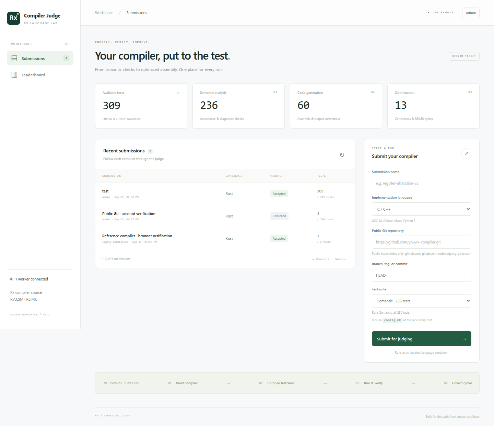
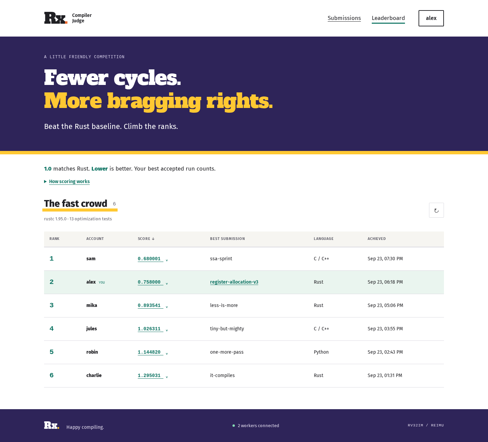
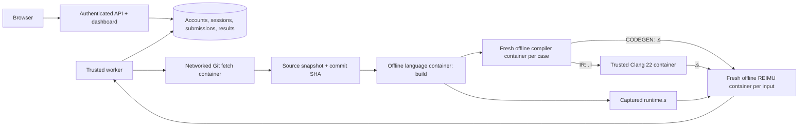

# Rx Online Judge

A compiler-course judge for the [`rx-compiler`](vendor/rx-compiler/README-EN.md)
project. Students sign in with administrator-provisioned accounts and submit a **public
Git repository**, its branch/tag/commit, an implementation language, and a whole test
suite. The judge fetches the source, builds the compiler, and runs Rx tests in containers.



The screenshots use illustrative submissions and rankings.

## Suite progression

There are four selectable suites. Later suites always include all earlier suites,
with execution ordered semantic → IR → codegen → optimization:

| Selected suite | What runs | Current official test count |
|---|---|---:|
| Semantic | Every semantic testcase | 236 |
| LLVM IR | Every semantic testcase, then all 60 codegen fixtures through `IR` | 296 |
| Code generation | Semantic + IR, then the same 60 fixtures through `CODEGEN` | 356 |
| Optimization | Semantic + IR + codegen, then all 13 optimization testcases | 369 |

IR and codegen share source files and input/output pairs. The catalog derives an IR
check from each codegen manifest entry; no duplicate fixtures or manifest changes are
needed. Counts come from the configured manifests; they are not hardcoded into grading.
There is no per-testcase or directory filter, and the API rejects extra selection fields.
All selected tests run even if an earlier test fails. A submission is accepted only if
all tests pass. Per-case diagnostics remain visible for debugging.

Official testcases are pinned in this repository's `testcases/official` Git submodule:
[ACMClassCourse-2025/rx-compiler-testcases](https://github.com/ACMClassCourse-2025/rx-compiler-testcases).
The judge loads manifests from `./testcases`; Compose mounts this directory read-only
at `/tests` for the API, worker, and baseline generator. Initialize it with `make init`
or `git submodule update --init --recursive` after cloning. The `tests/` directory
contains the judge's own automated tests and smoke fixtures.

To update to a newer official testcase revision:

```sh
git submodule update --remote testcases/official
git add testcases/official
git commit -m "Update official testcases"
docker compose restart api worker
make baseline
```

The committed submodule revision makes deployments reproducible. Changes to testcase
contents change the catalog fingerprint, so submissions must run again against that catalog.

## Optimization leaderboard



The **Leaderboard** page ranks active accounts by their best fully accepted optimization
submission against the current test catalog. Every semantic, IR, and codegen testcase must pass
too. Optimization cases use `CODEGEN`, so the scored assembly is produced by the submission. Each account has one entry; lower scores rank higher, and equal scores share a rank.
For equally scoring submissions from one account, the earliest completed one is shown.
All signed-in accounts can see the rankings and expand scores to inspect testcase ratios.
Submission diagnostics remain accessible only to the owner and administrators.

For optimization testcase `i`, first sum REIMU cycles over **all its input/output pairs**.
The official Rust baseline is the smallest correct total for that testcase across
`-C opt-level=0, 1, 2, 3, s, z`. Each variant uses the corresponding Cargo release
optimization level for the reference runtime as well, with the template's other flags
(including fat LTO) retained. A variant must pass every input of a testcase to supply its
baseline; compile failures, REIMU errors, timeouts, and nonpositive cycles are excluded.
The best flag may differ between testcases; inputs within a testcase use one variant.

```text
baseline_i = min(total cycles of each correct Rust variant for testcase i)
ratio_i    = submission_cycles_i / baseline_i
score      = exp(sum(log(ratio_i)) / number_of_optimization_testcases)
```

Each testcase has equal weight in the geometric mean. `1.0` matches the baseline;
`0.8` means a geometric mean cycle ratio of 80%; `1.2` means 120%. There is no cap or
inversion. Failed, incomplete, cancelled, older-catalog, and ownerless legacy submissions
do not rank. Accepted submission details also show the score and testcase breakdown.

After building images and starting the judge, generate the baseline:

```sh
make baseline
# Equivalent:
make setup
docker compose run --rm --no-deps baseline
```

This uses the official Rust toolchain in the configured `rust` language image, testcases
from this repository's `testcases/official` submodule, the reference helpers and `config.mk`
from the pinned `vendor/rx-compiler` submodule, and the judge's trusted REIMU image.
Set `RX_REFERENCE_PATH` for a different reference checkout. Compilation and execution
use the same offline containers, limits, inputs, and correctness checks as submissions.
The baseline job measures optimization tests only; student submissions still run the
complete cumulative suite.

Publication is atomic: every optimization testcase must have a valid baseline before it
replaces the active one. Failed or interrupted generation leaves the previous baseline
active. The database retains previous baseline records. Full measurements, diagnostics,
Rust version, image IDs, source fingerprint, and catalog fingerprint are also saved to
`/data/optimization-baseline.json` in the persistent judge volume. Export them with:

```sh
docker compose cp api:/data/optimization-baseline.json ./data/optimization-baseline.json
```

Existing accepted submissions receive scores immediately when a matching baseline is
activated. Regenerate after changing the catalog, reference compiler, or runtime. A
catalog mismatch disables scoring until a new baseline and matching submissions exist.
If the REIMU image or runtime configuration changes, rerun submissions as well; historical
submissions record the catalog version but do not record the runtime image they used.

For local development using `./data`:

```sh
uv run python -m rx_oj.baseline --reference-dir vendor/rx-compiler \
  --output data/optimization-baseline.json
```

## Start the judge

Requirements: Linux Docker with cgroup limits, Docker Compose, and Python 3 for setup
scripts. This repository pins `rx-compiler` at `vendor/rx-compiler` for reference
helpers and optimization baseline generation. Its nested `vendor/REIMU` submodule
supplies the simulator for the judge's runtime image. No sibling checkout is needed:

```text
rx-online-judge/
├── testcases/
│   └── official/          # This judge's pinned testcase submodule
└── vendor/
    └── rx-compiler/       # Pinned reference compiler submodule
        └── vendor/
            └── REIMU/     # Simulator pinned by rx-compiler
```

From `rx-online-judge`:

```sh
make init
python3 scripts/build_images.py
make up
```

The dashboard is at **http://localhost:8000**. The API binds to loopback by default.
Create accounts before signing in; there is no default password or web registration.
`make init` initializes the testcase and reference compiler submodules recursively,
including REIMU. It also migrates the previous generated `RX_TESTS_PATH` setting to
`./testcases` in an existing `.env`, while preserving other settings and custom
testcase paths.

`make up` and `make baseline` refresh `OJ_DOCKER_GID` from the configured Docker socket
before starting containers, including when `.env` already exists or was copied from another
machine. The worker runs as a non-root user and needs this supplementary group to access
Docker. Run `make setup` to refresh these settings separately; it reports an error if the
socket is missing or is not a Unix socket. Other settings in `.env` are preserved.

## Accounts and administration

Provision accounts through the operator CLI, which prompts for a password without echoing it:

```sh
docker compose exec api python -m rx_oj.admin create-user admin --admin
docker compose exec api python -m rx_oj.admin create-user alice
docker compose exec api python -m rx_oj.admin list-users
docker compose exec api python -m rx_oj.admin reset-password alice
docker compose exec api python -m rx_oj.admin disable-user alice
docker compose exec api python -m rx_oj.admin enable-user alice
```

Use `--password-stdin` on create/reset for provisioning scripts; do not pass passwords in
command-line arguments. Passwords must have 12–256 characters. Usernames are normalized to
lowercase and have 3–40 letters, digits, dots, underscores, or hyphens.

- Students list, inspect, and cancel **their own** submissions.
- Administrators can inspect and cancel all submissions. Creating/resetting/disabling
  accounts is an operator CLI action, not a public website endpoint.
- Users can change their own password from the account dialog.
- Passwords use individually salted scrypt hashes (`N=32768, r=8, p=3`).
- Sessions expire after 12 hours. Only token hashes are stored in SQLite. Cookies are
  HttpOnly and SameSite=Strict; state-changing requests also require a CSRF token.
- Logout revokes the current session. Password resets/changes and account disabling
  revoke every session belonging to the user. Login failures are throttled per username
  and client IP over a five-minute window.

For HTTPS deployment, set `OJ_SECURE_COOKIES=1` and configure Uvicorn's trusted proxy
settings to recognize your proxy's forwarded scheme. Browser origins must match the API
origin. There is no cookie-free shared-token or unauthenticated development bypass.

## Submit from Git

Provide a public HTTPS repository URL and a Git ref, for example:

```text
Repository: https://github.com/your-account/rx-compiler.git
Git ref:    main
Language:   Rust
Suite:      Code generation
```

`HEAD` uses the repository's default branch. Branches, tags, `refs/heads/...`, and commit
SHAs are supported. **A moving branch is resolved when the worker fetches it**; submit a
full commit SHA when you need an exact revision. Every successful fetch records its actual
commit SHA in the result and stores a bounded source snapshot for traceability.

Only public repositories are supported: no credentials, private access tokens, SSH URLs,
local paths, arbitrary transports, or uploaded archives. The default allowed hosts are
`github.com`, `gitlab.com`, `codeberg.org`, and `gitee.com`. Operators can configure
`OJ_GIT_HOSTS` identically on API and worker for other trusted public HTTPS Git hosts.
Git redirects, interactive prompts, credential helpers, hooks, recursive submodules,
and automatic Git LFS downloads are disabled. Use the canonical repository URL if it has
moved. Commit all required source/dependency files directly into the repository.

The repository must contain `config.mk` and the compiler source at its root. Ordinary
file symlinks, such as the template's README link, are materialized safely inside the
source archive. Directory, dangling, cyclic, and escaping links are rejected. Source
archives are never extracted onto the host.

The reference compiler repository is:

```text
https://github.com/ACMClassCourse-2025/rx-compiler.git
```

Select **Rust** and use a revision whose `config.mk` defines `IR` for any suite beyond
Semantic. Older revisions without `IR` can still submit the Semantic suite.

## Compiler contract

```make
BUILD = g++ -std=c++23 -O2 src/main.cpp -o compiler && cp runtime.s {runtime}
SEMANTIC = ./compiler --stage semantic {source}
IR = ./compiler --stage ir {source} -o {output}
CODEGEN = ./compiler --stage codegen {source} -o {output}
```

- `BUILD` runs once and may be empty. `/workspace` is snapshotted after building.
  `{runtime}` points to an initially empty assembly file outside that snapshot. `BUILD`
  may copy or generate shared runtime assembly there; the judge captures its bytes when
  the build succeeds. Leave it empty if the compiler embeds its runtime in each program.
- `SEMANTIC` exits **0** to accept and **1** to reject. Other exits, signals, and timeouts
  fail even negative testcases.
- `IR` exits 0 and writes LLVM IR to `{output}` (`.ll`), compatible with **Clang 22**.
  The judge lowers it to RV32IM assembly in a separate trusted Clang container.
- `CODEGEN` exits 0 and writes RV32IM assembly to `{output}` (`.s`).
- Both outputs may call symbols defined in the runtime from `BUILD`. Runtime assembly
  must use RV32IM and the ILP32 calling convention, with globals for exported functions.
  Programs must define a global `main`; REIMU also supplies its supported libc functions.
- The runtime must remain a regular file, at most 8 MiB (the artifact limit). Empty is valid;
  missing files, symlinks, directories, and oversized files fail the build. The captured
  runtime is supplied unchanged to every IR, codegen, and optimization execution.
  Changes to `{runtime}` during testcase compilation do not affect execution.
- `{source}`, `{output}`, and `{runtime}` are substituted as shell-quoted absolute paths. Make variable
  expansion is supported. Commands run in `/workspace`.
- The worker always runs its trusted REIMU image; a submission's `RUN` command is ignored.
- Outputs must match every input/output pair byte-for-byte, including final newlines.
- Optimization cases additionally report REIMU's `Total cycles: N`. Totals count only fully
  passing optimization cases.
- `lex` and `parse` manifests are skipped, matching the compiler template.

The fixed IR lowering command is:

```sh
clang-22 -S -x ir /case/program.ll -o /output/program.s \
  --target=riscv32-unknown-none-elf -march=rv32im -mabi=ilp32 \
  -O0 -mllvm -riscv-no-aliases
```

The judge removes DWARF `.debug_*` sections that REIMU cannot assemble, then executes
`reimu -f /case/program.s,/case/runtime.s` with judge-controlled input/output paths and
limits. Only emitted IR enters the Clang container. Student build scripts and Make
expressions execute in the language sandbox; neither repository `RUN` nor repository
Clang commands control judging. LLVM IR compilation errors appear in case diagnostics.

Implementation images support C/C++ (GCC 14), Rust 1.95 with the RV32IM target, Python 3.13,
Java 21, and Node.js 22. Build and execution containers have no network access; vendor
all dependencies or install them in operator-owned images. The tiny compilers in
`examples/python` and `examples/cpp` support only `tests/fixtures/suites` for installation
checks; they are not complete Rx compilers. Both demonstrate a shared runtime function
called from LLVM IR and direct assembly. The Rust reference embeds its runtime with
LTO and leaves `{runtime}` empty.

## Architecture and limits



Only the trusted worker has Docker access. Git fetching occurs in a separate container
that has networking but no host mounts or repository credentials and never executes repository code.
Compiler, Clang, and REIMU containers cannot access the network, Docker socket, database, host
directories, or expected test outputs. Grading happens in the worker.

Sandboxes run as UID 1000 with a read-only root filesystem, bounded tmpfs mounts, all
capabilities dropped, no-new-privileges, default Docker seccomp, and cgroup limits.

| Resource | Default |
|---|---:|
| Git fetch time | 120 seconds |
| Exported source / file count | 64 MiB / 10,000 |
| Built compiler snapshot | 256 MiB |
| Workspace / temporary directory | 512 MiB / 64 MiB |
| Build / compile / execution timeout | 120 / 30 / 10 seconds |
| Total submission timeout | 1 hour |
| Compiler and Git / REIMU memory | 1,024 / 512 MiB |
| CPU / process limit | 1 CPU / 64 processes |
| Generated IR, assembly, or runtime / program output | 8 MiB / 1 MiB |
| Captured diagnostics | 64 KiB per command |
| Queued + active submissions | 100 |

SQLite WAL and source snapshots persist in the `judge-data` named volume. Workers use
atomic claims, 10-second heartbeats, and leases. Stale workers cannot overwrite results;
the next live worker reaps expired work. Cancel requests terminate active containers.

```sh
docker compose logs -f worker
docker compose up -d --scale worker=2
docker compose down                 # Preserves the data volume
```

Restart API and workers after changing tests or `languages.toml`. Both processes must use
the same immutable test tree; mismatched fingerprints fail jobs. SQLite workers should
share local disk, not a network filesystem. Data is retained indefinitely; configure a
retention policy and backups for sustained use. Docker shares the host kernel; use dedicated
worker machines and an isolation runtime such as gVisor for public, hostile submissions.

Configuration: `OJ_DATA_DIR`, `OJ_TESTS_DIR`, `OJ_LANGUAGES_FILE`, `OJ_SECURE_COOKIES`,
`OJ_GIT_HOSTS`, `OJ_GIT_PROXY`, `OJ_GIT_IMAGE`, `OJ_IR_IMAGE`, `OJ_RUNTIME_IMAGE`, and
`OJ_DOCKER_RUNTIME`.
`OJ_IR_IMAGE` defaults to `rx-oj-clang:local`, built by `scripts/build_images.py`.
`OJ_DOCKER_RUNTIME=runsc` uses an already-installed gVisor runtime. Compose also supports
`OJ_PORT`, `RX_TESTS_PATH`, `OJ_DOCKER_SOCKET`, and `OJ_DOCKER_GID`. For a custom Docker
socket, set `OJ_DOCKER_SOCKET` in `.env` or export it before running `make setup` or
`make up`; an exported value takes precedence. Setup replaces a saved `OJ_DOCKER_GID`
with the socket's current group ID. Export `OJ_DOCKER_GID` only if you intentionally need
to override that detection.

If the worker fails at `docker.from_env()` with `PermissionError(13, 'Permission denied')`,
refresh the socket group and recreate the worker:

```sh
make setup
docker compose up -d --no-deps --force-recreate worker
docker compose logs --tail=50 worker
```

Recreation is necessary to apply changed supplementary groups; restarting an existing
container does not update them.

### Git fetch proxy

To fetch repositories through a proxy running on the Docker host, add this to `.env`
(replace `7890` with your proxy's port), then run `make up`:

```dotenv
OJ_GIT_PROXY=http://host.docker.internal:7890
```

The worker passes this URL to Git's `http.proxy` setting in each Git fetch container.
The hostname `host.docker.internal` maps to Docker's host gateway, including on Linux.
An HTTP proxy can tunnel the HTTPS repository requests; for a SOCKS5 proxy with proxy-side
DNS resolution, use `socks5h://host.docker.internal:7890`. A remote proxy URL also works.
Leave `OJ_GIT_PROXY` unset or empty to connect directly. For a worker run without Compose,
export the variable before starting it.

If your proxy listens only on the host's `127.0.0.1`, enable the optional Compose
forwarder in `.env` (Linux Docker Engine):

```dotenv
COMPOSE_PROFILES=git-proxy
OJ_GIT_PROXY_HOST_PORT=17890
OJ_GIT_PROXY_FORWARD_PORT=17891
OJ_GIT_PROXY=http://host.docker.internal:17891
```

Run `make up` to build and start the `git-proxy` service with the judge. It forwards
Docker bridge port `17891` to the existing host loopback proxy on port `17890`.
Set `OJ_GIT_PROXY_HOST_PORT` to your proxy's actual port; if you change
`OJ_GIT_PROXY_FORWARD_PORT`, use that port in `OJ_GIT_PROXY` too. For a SOCKS5 upstream,
use `socks5h://` in `OJ_GIT_PROXY`; the forwarder carries TCP without changing the protocol.
If you already enable other Compose profiles, append `git-proxy` to the comma-separated list.

The forwarder uses host networking to reach loopback and binds its listener only to
the Docker bridge address. It runs as a non-root user with a read-only filesystem and
no host mounts. The worker waits for its listener to be healthy when the profile is
enabled. `make down` stops it with the judge, and Docker restarts it after a reboot.
The original proxy must also be running. To disable forwarding, stop `git-proxy` before
removing its profile from `.env`, then update or clear `OJ_GIT_PROXY` and run `make up`.
Compose 2.20 or newer is required for the optional service dependency.

Host firewall rules must allow fetch containers to reach the forwarded port. No Compose
`ports:` entry or host systemd service is needed. The proxy is used only for Git fetching;
compiler and testcase containers remain offline.

## API

OpenAPI is at `/openapi.json`. All API endpoints except login and the public
`/api/catalog/summary` stage counts require an account session.
POST requests other than login require `X-CSRF-Token`, returned by login and `/api/auth/me`.

| Method | Path | Purpose |
|---|---|---|
| POST | `/api/auth/login` | JSON username/password; sets session cookie |
| GET | `/api/auth/me` | Current account and CSRF token |
| POST | `/api/auth/logout` | Revoke current session |
| POST | `/api/auth/password` | Change password; revoke all sessions |
| GET | `/api/catalog` | Four cumulative suites, counts, allowed Git hosts |
| GET | `/api/catalog/summary` | Public stage counts and total for the landing page |
| GET | `/api/languages` | Allowed compiler implementation languages |
| GET | `/api/health` | Worker connectivity and queue depth |
| GET | `/api/leaderboard` | Account rankings, active baseline, and testcase cycle ratios |
| POST | `/api/submissions` | Queue a public Git repository |
| GET | `/api/submissions?limit=30&offset=0` | Visible submission history |
| GET | `/api/submissions/{id}` | Results, Git revision, diagnostics, and optimization score |
| POST | `/api/submissions/{id}/cancel` | Cancel owned submission (or any as administrator) |

Submission JSON:

```json
{
  "name": "register-allocation-v2",
  "language": "rust",
  "repository_url": "https://github.com/your-account/rx-compiler.git",
  "git_ref": "main",
  "suite": "codegen"
}
```

`name` is optional. Omit it, pass `null`, or leave it blank to generate a name such as
`Run a1b2c3d4` from the submission ID. Custom names are trimmed and limited to 80 characters.
`git_ref` defaults to `HEAD`; `suite` must be `semantic`, `ir`, `codegen`, or `optimization`.
Extra fields such as `filter`, `stage`, and `case_ids` are rejected. Other users' submissions
return 404 to students. `source_error` indicates a repository fetch/ref/source-layout problem;
`build_error` indicates a compiler build failure. Other terminal states include `accepted`,
`failed`, `time_limit`, `cancelled`, and `system_error`.

The leaderboard reports `status: ready`, `missing`, or `stale`. Scores are calculated from
the active baseline at read time. Each ranked entry includes `rank`, `username`, `score`,
`submission_id`, `language`, `finished_at`, and per-testcase `cycles`, `baseline_cycles`,
and `ratio`. `optimization_score` in submission details is `null` when the submission or
baseline is ineligible. Leaderboard visibility does not grant access to another account's
submission details or cancellation endpoint.

## Upgrade for IR and runtime support

Rebuild sandbox images with `python3 scripts/build_images.py`, then rebuild and restart
the API and worker. Add `IR` to submission repositories and use `{runtime}` in `BUILD`
when a separate runtime is needed. The new grading contract changes the catalog
fingerprint: old results remain visible but cannot rank against the new catalog.
Run `make baseline` again and resubmit compilers to qualify for the leaderboard.

The Clang 22 upgrade pairs LLVM IR lowering with the Rust 1.95 reference toolchain
(LLVM 22). It also changes the catalog fingerprint, so Clang 20 results remain historical.
Rebuild the images and regenerate the Rust baseline when upgrading from that version.

## Upgrade from the shared-token version

The database migrates automatically and preserves submission history and results. Old
unowned submissions are visible only to administrators. Pending archive submissions no
longer have a Git source and finish as `source_error`; submit them again using a repository.
`OJ_API_TOKEN` is no longer used and can be removed from `.env`. Create an administrator
using the CLI after deploying the new version; existing accounts are never replaced.

## Development and validation

```sh
uv sync --frozen
make init
uv run python -m rx_oj.admin create-user admin --admin
make dev
# Separate terminal:
make worker
```

Development uses `./data` and `./testcases`; accounts are required here too.
For smoke fixtures, use `OJ_TESTS_DIR=tests/fixtures/suites` for both API and worker.
The frontend has no build step or CDN dependency. Its Rust-inspired typography and
Fellis illustration are bundled locally; see [asset sources and licenses](rx_oj/static/assets.md).
The landing page and testcase counts are visible before sign-in; submissions, results,
and rankings still require an account.

Submitting a compiler opens its dedicated `#run/<submission-id>` page. Run names and
status badges in the history open the same page, and its URL can be reloaded or
bookmarked. Ferris waits behind his skateboard in the queue, hops onto it when the
worker starts, and stays aboard when the run ends. Each stage has its own landscape.
Progress signs and the loading bar reflect
completed tests; workers also report repository fetching, building, and the current
testcase. The scene fills a narrow frame around the viewport, with a large stage
heading, a short caption, and a compact progress line. Scroll down to reveal the
phase indicators and bring the current test and System log beside the scene, or
scroll back up to expand the landscape again. The System log includes full compiler
build output and expandable testcase output. On smaller screens, the log sits below
the scene. Scenery scrolls past in continuous parallax while tests run; animation
respects the system’s reduced-motion preference. The top-right
Back to menu button returns to submissions.

```sh
make lint
make test
docker compose --profile git-proxy build git-proxy  # Image for the loopback forwarding test
make test-docker             # Requires Git, Python, C++, Rust, Clang, and REIMU images
OJ_TEST_DOCKER=1 OJ_TEST_GIT_NETWORK=1 uv run pytest -q
# The opt-in network test additionally uses Git and Rust images and public GitHub access.
```

Tests cover accounts, password resets, expiry, CSRF, ownership, administrator access,
login throttling, migration, Git URL/ref validation, cumulative suites, queue concurrency,
geometric-mean scoring, baseline selection, ranking ties, score visibility, and container
execution, separate IR lowering, and immutable shared runtime artifacts. The opt-in
network test submits the public Rx reference repository through login, Git fetch, build,
and semantic checking. Container tests exercise all four cumulative stages using the
examples and check the pinned Rust reference submodule through both IR and codegen.

Add language images and their IDs to `languages.toml` to extend toolchain support.
Images need `/bin/sh`, `sleep`, `tar`, Python 3, GNU Make, the language toolchain, and
`sandbox/` under `/opt/rx-oj/`. Submitters cannot choose arbitrary Docker images or mounts.
